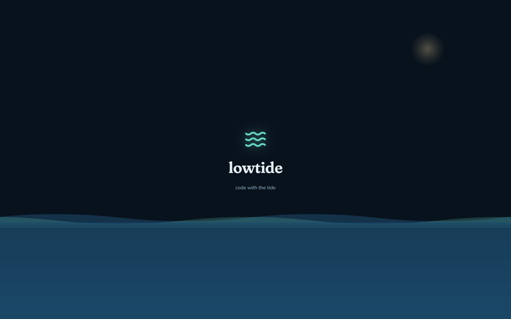
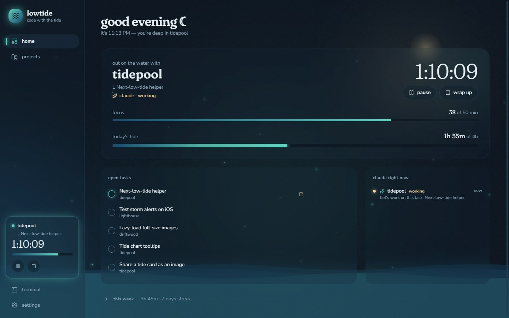
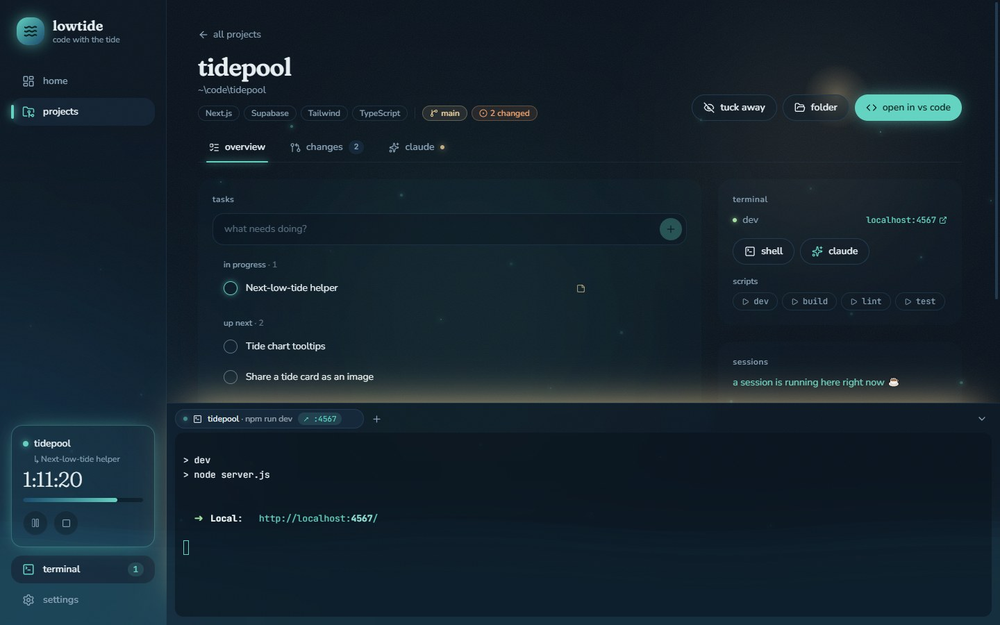
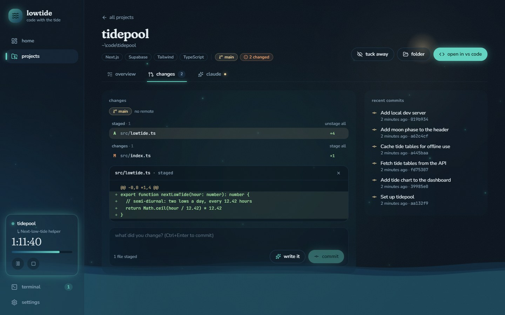

<div align="center">



# lowtide

**A cozy coding command center. Open it when you sit down to code.**

It knows your projects, keeps the time, holds your tasks, and gathers VS Code, git, a terminal and Claude Code in one calm, night-ocean-themed place.

</div>

---



## What it does

### 🌊 Sessions and the tide

- **Start a session** on a project and Lowtide keeps the clock. Pause and resume, then wrap up with a note for future you. The summary lists the commits you made and the tasks you finished.
- **Only focus time counts.** It pauses itself after a few idle minutes (and gives that time back), when you lock the screen, or when the app closes. If it crashes, the session comes back paused and the downtime isn't counted.
- **The tide** is today's focus time as water: it rises along the bottom of the window toward a daily goal you set.
- **A focus rhythm** suggests a break after each block (50/10 by default), with "5 more minutes" or a break countdown. Stepping away long enough counts as a break on its own.
- **Home is a "today" view:** what you're working on, or _pick up where you left off_, with your last note and next task.

### 🗂️ Projects and tasks

- Point Lowtide at your folders and it **finds every git repo**, guessing the stack (Next.js, Expo, Electron, Supabase, Flutter, Python and more).
- **Each project page** has a calm header (stack, branch, changes) and three tabs: **overview**, **changes** and **claude**.
- **Tasks per project:** in progress, up next and done, with notes. Drag to reorder. Tasks you finish during a session show up in its summary.



### 🖥️ A built-in terminal

- **A dock** that slides up from any page (**Ctrl+`**), with real PowerShell or Git Bash tabs that keep running while you move around.
- **Run any npm script** with one click. Dev-server addresses (`localhost:5173`) are picked up automatically and shown as chips you can open.
- **Session recipes:** each project remembers what "start a session" sets up. Open VS Code, run `npm run dev`, open the app in your browser once it's ready, and hand Claude your next task.

### 🔀 Git without leaving

- **Stage** whole files, **review diffs**, **commit** (Ctrl+Enter), **push** and **pull**.
- **Pull is fast-forward only**, so there are no surprise merge commits. Errors read like plain English ("the remote has commits you don't have yet — pull first").
- **✦ write it:** Claude drafts a commit message from your staged changes, in the style of your recent commits.



### ✦ Claude Code, connected

- **Claude tabs** run Claude Code inside the project.
- **✦ on any task** opens Claude with that task as its first message ("look first, plan before changing anything").
- **Live status:** once connected, every Claude session (even ones started outside Lowtide) shows as _working_, _needs you_ or _your turn_, on its tab and the home screen. A notification taps you on the shoulder when Claude is waiting.
- **Claude history** per project, with a **resume** button that reopens any earlier conversation.

### 🌙 The feel

Night water, moonlight and sea glass, glowing plankton, slow waves, a soft serif for titles, and a tide that rises as you open the app. Everything stays dark, gentle and quiet. Motion respects your system's reduce-motion setting.

## Getting started

**You'll need**

- Windows 10 or 11 (the app is built and tested on Windows)
- [Node.js](https://nodejs.org) 20 or newer, and [git](https://git-scm.com)
- _Optional:_ [VS Code](https://code.visualstudio.com) with its `code` command on PATH, for "open in VS Code"
- _Optional:_ [Claude Code](https://docs.anthropic.com/en/docs/claude-code), for Claude tabs, live status and commit drafts. Install it from PowerShell with `irm https://claude.ai/install.ps1 | iex`. The live-status hook is a tiny Node script, so Node needs to be on PATH.

**Run it**

```bash
npm install
npm run dev
```

**Build a Windows installer** (it lands in `dist/`)

```bash
npm run build:win
```

**First steps**

1. **settings → project folders:** add the folder(s) where your projects live, e.g. Desktop.
2. **settings → claude code → connect** (optional): turns on live Claude status.
3. Press **start a session** and pick a project. Set its recipe in the same dialog.

## Your data stays on your machine

- **Everything is local.** All data lives in one SQLite file at `%APPDATA%\lowtide\lowtide.db`. There's no account, no cloud and no telemetry.
- **Git uses your own credentials** (Git Credential Manager), and Lowtide never sees a password.
- **Connecting Claude Code** adds a few hooks to `~/.claude/settings.json` (a backup is saved first) and a tiny script at `~/.lowtide/claude-hook.js`.
  - The script sends Claude's events to Lowtide on `127.0.0.1` only.
  - Requests from web pages are rejected.
  - If Lowtide isn't running, the script gives up silently.
  - **Disconnect** removes only Lowtide's hooks.
- **Upgrading from CodeHub** (Lowtide's earlier name)? Your data is imported automatically from `%APPDATA%\codehub` on first start. The old folder is kept as a backup.

## Built with

[Electron](https://www.electronjs.org) · [electron-vite](https://electron-vite.org) · [React 19](https://react.dev) · TypeScript · [Tailwind CSS 4](https://tailwindcss.com) · [better-sqlite3](https://github.com/WiseLibs/better-sqlite3) · [node-pty](https://github.com/microsoft/node-pty) and [xterm.js](https://xtermjs.org) · [simple-git](https://github.com/steveukx/git-js) · [Lucide](https://lucide.dev) icons · Fraunces, Nunito and JetBrains Mono fonts (bundled, so it works offline).

## Project layout

```
src/
  main/        Electron main process: the "engine"
    db/          SQLite access and migrations (one file per area)
    services/    sessions, focus, idle, git, terminals, Claude hooks, recipes…
    ipc.ts       every call the UI can make
  preload/     the typed window.api bridge
  shared/      types shared by both sides (api.ts is the contract)
  renderer/    the React UI
    src/lib/       logic and API wrappers (plain .ts)
    src/hooks/     React hooks over lib/
    src/components/, src/pages/   display only
    src/assets/main.css           design tokens: every color, font and animation
```

**Conventions**

- **Logic** lives in `lib/` and `hooks/`; components only render.
- **Colors** come from the tokens in `main.css`, never hard-coded in components.
- **Long-running state** lives in the main process (session clock, terminals, Claude status), so a window reload loses nothing.

## Development

```bash
npm run dev          # app with hot reload
npm run typecheck    # TypeScript (main and renderer)
npm run lint         # ESLint
npm run format       # Prettier
```

**Testing without touching your data**: run against a separate database and hook port:

```bash
LOWTIDE_DATA_DIR=/tmp/lowtide-test LOWTIDE_HOOK_PORT=47822 npm run dev
```

**Gotchas worth knowing**

- **Native modules:** better-sqlite3 and node-pty ship prebuilt binaries for Node and Electron, so no compiler is needed. (That's why there's no `electron-builder install-app-deps` step.)
- **Launching from inside Claude Code:** when Lowtide itself is started from a Claude Code terminal, it strips that session's `CLAUDE*` variables from the processes it launches. Otherwise nested Claude sessions wouldn't be saved.
- **Only one Lowtide per data folder:** opening it again focuses the existing window.

## Roadmap

- [ ] **Ctrl+K** command bar
- [ ] **Weekly recap** and a focus **heatmap**
- [ ] **Project links** (repo, dashboards, live site)
- [ ] **Tray icon and mini timer**
- [ ] **✦ Review before commit:** Claude checks your staged diff
- [ ] **✦ Write-ups:** changelog, standup, PR and client updates from your sessions
- [ ] **Freelance hours:** clients, hours per client and period, CSV export
- [ ] **Repo warnings** on the home screen (uncommitted or unpushed work)

---

<div align="center"><sub>made for slow, focused evenings · code with the tide 🌊</sub></div>
